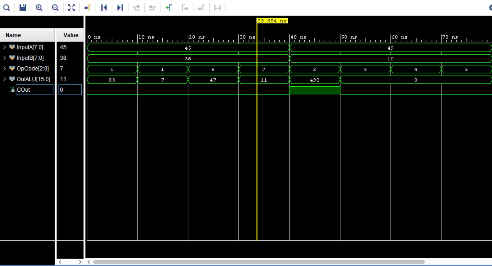
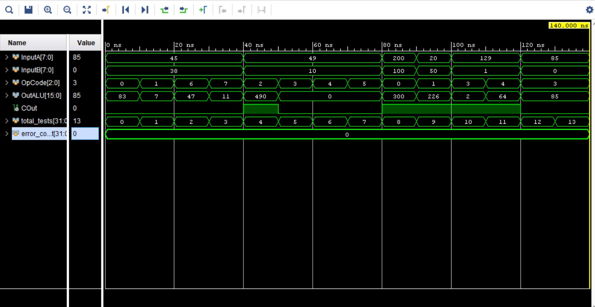

# 8-Bit Arithmetic Logic Unit (ALU) with Self-Checking Testbench (Verilog)

A synthesizable Register-Transfer Level (RTL) implementation of an 8-bit Arithmetic Logic Unit designed in Verilog HDL, paired with a self-checking verification environment and simulated using **AMD Xilinx Vivado 2018.2**.

## Core Architecture & Features

- **8-Function Combinational Datapath:** Executes arithmetic, logical, and bit-shift operations selected via a 3-bit opcode (`OpCode[2:0]`).
- **Flag & Width Management:** Uses a 16-bit output bus (`OutALU[15:0]`) to preserve full multiplication precision and a dedicated `COut` status flag for carry-out, borrow, multiplication overflow, and shift-out tracking.
- **Synthesizable RTL:** Implemented using combinational `always @(*)` logic with named `localparam` opcodes and complete default assignments to prevent unintended latch inference.

## Supported Operations

| OpCode | Parameter | Operation | `COut` Flag Behavior |
| :--- | :--- | :--- | :--- |
| `000` | `OP_ADD` | Addition (`A + B`) | Unsigned carry-out (`add_result[8]`) |
| `001` | `OP_SUB` | Subtraction (`A - B`) | Borrow indicator (`A < B`) |
| `010` | `OP_MUL` | Multiplication (`A * B`) | Set if upper product byte is nonzero |
| `011` | `OP_LSL` | Logical Shift Left (`A << B[3:0]`) | Last bit shifted out of MSB (for shifts 1–7) |
| `100` | `OP_LSR` | Logical Shift Right (`A >> B[3:0]`) | Last bit shifted out of LSB (for shifts 1–7) |
| `101` | `OP_AND` | Bitwise AND (`A & B`) | Always `0` |
| `110` | `OP_OR` | Bitwise OR (`A \| B`) | Always `0` |
| `111` | `OP_XOR` | Bitwise XOR (`A ^ B`) | Always `0` |

**Subtraction convention:** The subtraction result is an 8-bit modulo-256 result, zero-extended to 16 bits. `COut = 1` indicates a borrow (`A < B`).

**Shift behavior:** The lower four bits of `InputB` determine the shift amount (`0` to `15`). A shift amount of `0` passes `InputA` through unchanged (`COut = 0`). Shift amounts from `1` to `7` output the shifted value and capture the last shifted-out bit in `COut`. Shift amounts from `8` to `15` produce a zero output (`OutALU = 0`, `COut = 0`).

**Multiplication overflow:** `COut = 1` when the upper eight bits of the 16-bit multiplication result are nonzero.

## Verification Methodology

The verification environment was structured in two stages to demonstrate systematic debugging and corner-case coverage.

### 1. Initial Directed Testbench (`alu_8bit_tb_initial.v`)

The initial AI-generated testbench verifies basic functional behavior across all eight opcodes using two nominal operand pairs (`A=45, B=38` and `A=49, B=10`). It displays the simulation outputs for inspection.

### 2. Self-Checking Verification Suite (`alu_8bit_tb_final.v`)

The refined testbench replaces manual output checking with a reusable Verilog `check_alu` task and a **lightweight scoreboard** (`total_tests` and `error_count`).

It expands verification to **13 test vectors**, covering:

- Nominal functional cases across all eight operations.
- Addition carry-out (`200 + 100`).
- Subtraction borrow (`20 - 50`).
- Single-bit shift-out tests for the MSB and LSB (`129 << 1` and `129 >> 1`).
- Zero-shift pass-through (`85 << 0`).
- Out-of-bounds shift zero-output behavior (`shift_amt = 10`, verifying the `shift_amt >= 8` condition).

The testbench compares actual and expected outputs using case inequality (`!==`) and automatically reports PASS/FAIL results.

### Initial Directed Simulation Waveform



### Final Self-Checking Simulation Waveform (13 Vectors, 0 Errors)



### Terminal Verification Log

```text
=========================================================
  8-BIT ALU SELF-CHECKING VERIFICATION START
=========================================================
PASS [Test 1] @ 10 ns | Op=000 A=45 B=38 | Out=83 COut=0
PASS [Test 2] @ 20 ns | Op=001 A=45 B=38 | Out=7 COut=0
PASS [Test 3] @ 30 ns | Op=110 A=45 B=38 | Out=47 COut=0
PASS [Test 4] @ 40 ns | Op=111 A=45 B=38 | Out=11 COut=0
PASS [Test 5] @ 50 ns | Op=010 A=49 B=10 | Out=490 COut=1
PASS [Test 6] @ 60 ns | Op=011 A=49 B=10 | Out=0 COut=0
PASS [Test 7] @ 70 ns | Op=100 A=49 B=10 | Out=0 COut=0
PASS [Test 8] @ 80 ns | Op=101 A=49 B=10 | Out=0 COut=0
PASS [Test 9] @ 90 ns | Op=000 A=200 B=100 | Out=300 COut=1
PASS [Test 10] @ 100 ns | Op=001 A=20 B=50 | Out=226 COut=1
PASS [Test 11] @ 110 ns | Op=011 A=129 B=1 | Out=2 COut=1
PASS [Test 12] @ 120 ns | Op=100 A=129 B=1 | Out=64 COut=1
PASS [Test 13] @ 130 ns | Op=011 A=85 B=0 | Out=85 COut=0
=========================================================
  VERIFICATION COMPLETE
  TOTAL TESTS = 13
  ERROR COUNT = 0
  STATUS      = ALL TESTS PASSED
=========================================================
```

## Tools & Technologies

- **Hardware Description Language:** Verilog HDL
- **Simulation and Verification:** AMD Xilinx Vivado 2018.2
- **Target FPGA:** Artix-7 (`xc7a50tftg256-1`)
- **Design Type:** Combinational RTL

## Repository Structure

8Bit-ALU-SelfChecking-Verification/
│
├── README.md
├── alu_8bit.v
├── alu_8bit_tb_initial.v
├── alu_8bit_tb_final.v
├── initial_simulation_tb.PNG
└── final_simulation_tb.PNG
```

## Project Outcome

Successfully implemented and simulated an 8-bit combinational ALU supporting eight operations. Developed an AI-assisted, self-checking testbench with automated output comparison and scoreboard-based result reporting.

**Final Verification Result: 13 test vectors passed with 0 errors.**
